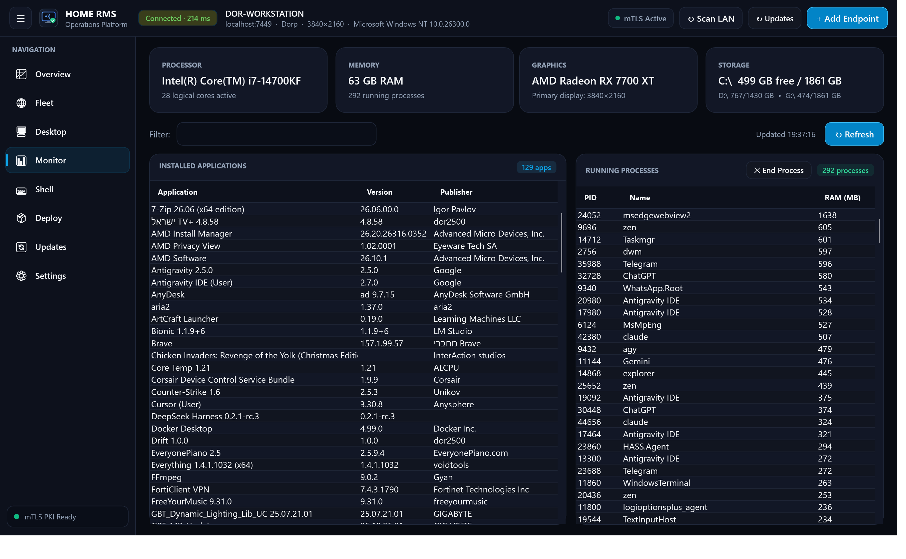
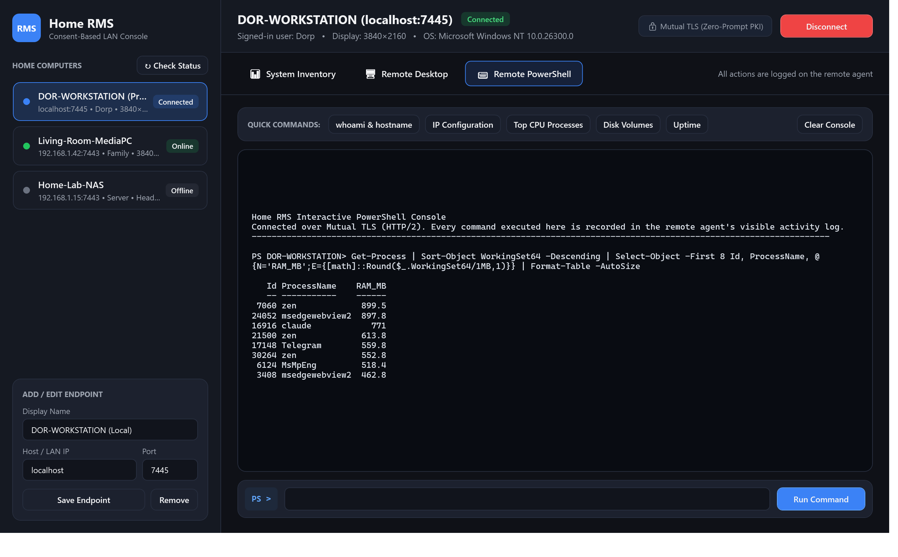

<p align="center">
  
</p>

<h1 align="center">Home RMS — Consent-Based LAN Remote Management System (.NET 9)</h1>

<p align="center">
  A modern, self-hosted <b>Remote Management System (RMS)</b> built in <b>.NET 9 / C#</b> for administering computers on your home LAN with <b>Mutual TLS (Zero-Prompt PKI)</b> authentication, <b>explicit on-device user consent</b>, and <b>full audit logging</b>.
</p>


---

## Visual Tour & Screenshots

### 1. Controller Console — System Inventory & Hardware Dashboard
Displays saved home computers with live online/offline status probing, hardware summary cards (CPU, RAM, GPU & Display, Storage Volumes), real-time search filtering, installed applications (from the Windows Registry), and active processes sorted by memory usage.



### 2. Controller Console — Live Remote Desktop & Input Control
Streams the remote desktop over gRPC/HTTP2 with configurable target FPS and JPEG quality, letterboxing-aware coordinate mapping, and live mouse/keyboard injection via Win32 `SendInput`.


### 3. Controller Console — Interactive Remote PowerShell
Full bidirectional PowerShell session over Mutual TLS with one-click diagnostic quick-commands (`whoami & hostname`, `IP Configuration`, `Top CPU Processes`, `Disk Volumes`, `Uptime`) and command history (`Up`/`Down` arrows).



### 4. Client Agent — Endpoint Monitor & Live Activity Audit Log
Runs in the signed-in user's interactive session with a system tray icon, status cards, active session indicator, one-click **Stop Session** revocation button, and a live timestamped audit log of every remote action.


---

## Key Features & Architecture

```text
HomeRms.sln
├── src/HomeRms.Shared          # gRPC Protobuf contract (rms.proto) + Mutual-TLS PKI generator & loader
├── src/HomeRms.Agent           # Windows-only WinForms tray & endpoint monitor hosting Kestrel gRPC server over mTLS
├── src/HomeRms.Controller      # Windows dark-themed WPF console with multi-device sidebar & 3 modules
├── src/HomeRms.Controller.Mac  # macOS native Controller app (Avalonia UI, Apple Silicon arm64 & Intel x64)
├── tools/New-DevCerts.ps1      # One-time deployment PKI certificate generator (CA + Agent + Controller)
├── tools/Package-MacController.ps1 # Packages HomeRmsController.app bundles (.icns + Info.plist) for macOS
└── tests/HomeRms.LoopbackTest  # Automated end-to-end integration test suite (info, inventory, shell, consent, screen)
```

### 1. Zero-Prompt Mutual-TLS (mTLS) Authentication & EKU Hardening
Instead of typing passwords or hardcoding a plain pre-shared key into the binary, each deployment uses a dedicated 3-certificate PKI embedded inside the build and synced automatically on first run (`%ProgramData%\HomeRMS\certs` on Windows, `~/Library/Application Support/HomeRMS/certs` on macOS):

| Certificate | File | Role & EKU |
|---|---|---|
| **Root CA** | `homerms-ca.pfx` | Self-signed deployment Certificate Authority trusted by both sides |
| **Agent Server Cert** | `homerms-agent.pfx` | Server certificate (`serverAuth` OID `1.3.6.1.5.5.7.3.1` + LAN SANs) |
| **Controller Client Cert** | `homerms-controller.pfx` | Client certificate (`clientAuth` OID `1.3.6.1.5.5.7.3.2`) presented automatically by the Controller |

Both Kestrel (on the Agent) and `SocketsHttpHandler` (on the Controller) enforce **TLS 1.2 / TLS 1.3**, validate certificates against your deployment's custom `homerms-ca` root thumbprint, and strictly verify the **Extended Key Usage (EKU)** OID (`clientAuth` vs `serverAuth`) so an Agent certificate can never impersonate a Controller client certificate.

### 2. Consent-First Security Model
Unlike covert surveillance tools, **Home RMS** is designed around transparency and user consent:
- **Interactive User Session:** Runs as a visible application in the signed-in user's desktop session with a system tray icon.
- **Explicit On-Screen Prompt:** Starting a Remote Desktop stream triggers a modal **Allow / Deny** dialog on the remote computer showing the operator's certificate identity (`homerms-controller`).
- **Persistent Red Viewing Banner:** Whenever a screen stream is active, an always-on-top red banner is displayed at the top of the remote screen with a one-click **Stop** button.
- **Time-Boxed Grants & Instant Revocation:** Consent grants expire automatically after 1 hour and can be revoked at any moment from the banner, the Agent window, or the system tray menu.
- **Full Audit Log:** Every connection, inventory query, PowerShell command, and screen session is recorded with timestamps in the Agent's `LIVE AUDIT & ACTIVITY LOG`.

### 3. Core Modules
- **System Inventory & Process Control (`InventoryCollector.cs` & `KillProcess`):**
  - Reads `HKLM` (64-bit and `WOW6432Node`) and `HKCU` uninstall registry hives, deduplicating and sorting installed applications.
  - Enumerates all running processes and their working-set RAM consumption, with one-click **✕ End Process** termination directly from the Controller.
  - Queries WMI (`Win32_Processor`, `Win32_ComputerSystem`, `Win32_VideoController`) and `DriveInfo` for CPU model, logical cores, physical RAM, GPU adapter, and fixed disk capacity/free space.
- **Remote Desktop, Full Screen Mode, Bidirectional Copy-Paste & Input (`ScreenCapturer.cs` & `InputInjector.cs`):**
  - Captures the primary display at physical DPI resolution using Win32 GDI `BitBlt` (`SRCCOPY | CAPTUREBLT`), overlays the live cursor position via `GetCursorInfo` + `DrawIcon`, and encodes frames as JPEG.
  - **Full Screen Mode (`⛶ Full Screen` / `F11` / `Esc`):** Expands the remote desktop stream edge-to-edge across your monitor with a floating HUD bar.
  - **Bidirectional Copy & Paste (`GetClipboard` / `SetClipboard`):** Includes **📋 Paste to Remote** and **📥 Copy from Remote** buttons, plus automatic clipboard synchronization whenever you press `Ctrl+V` / `Cmd+V` or `Ctrl+C` / `Cmd+C` inside the Remote Desktop view.
  - Maps mouse movement, clicks (`Left`, `Right`, `Middle`), scroll wheel deltas, and keyboard virtual-key codes from the Controller's letterboxed viewport to normalized `0..65535` absolute coordinates injected via Win32 `SendInput`.
- **Silent Software Deployment (`RemoteManagementService.DeployPackage`):**
  - Streams any local `.exe`, `.msi`, `.msp`, or `.ps1` installer package in 256 KB chunks over Mutual TLS to the remote computer (supports Drag & Drop or File Picker).
  - **Smart Silent Flag Auto-Detection (`AUTO`):** Inspects `.exe` binaries to automatically apply silent installation flags for **Inno Setup** (`/VERYSILENT /SUPPRESSMSGBOXES /NORESTART /SP-`), **NSIS** (`/S`), **WiX Burn** (`/quiet /norestart`), **InstallShield** (`/s /v"/qn /norestart"`), and **Windows Installer `.msi`** (`msiexec /i ... /qn /norestart`).
  - Includes **One-Click Winget Silent Install** shortcuts for popular packages (`7-Zip`, `Google Chrome`, `Mozilla Firefox`, `VLC`, `Notepad++`, `VS Code`).
- **Remote PowerShell (`RemoteManagementService.Shell`):**
  - Spawns an isolated, hidden `powershell.exe` process connected to a gRPC bidirectional stream (`AsyncDuplexStreamingCall`), streaming `stdout` and `stderr` in real time.

---

## Building from Source

Requires the **.NET 9 SDK** on Windows 10/11.

```powershell
# Compile the entire solution in Release mode
dotnet build HomeRms.sln -c Release

# Publish standalone single-file Windows Release executables into ./dist
dotnet publish src/HomeRms.Agent/HomeRms.Agent.csproj -c Release -r win-x64 --self-contained false -p:PublishSingleFile=true -o dist
dotnet publish src/HomeRms.Controller/HomeRms.Controller.csproj -c Release -r win-x64 --self-contained false -p:PublishSingleFile=true -o dist

# Package self-contained macOS Controller .app bundles (Apple Silicon arm64 & Intel x64) into ./dist
./tools/Package-MacController.ps1
```

---

## Deployment & Usage Guide

### Step 1: Generate Deployment Certificates (Once per Home Network)
Run the included PowerShell script to generate `homerms-ca.pfx`, `homerms-agent.pfx`, and `homerms-controller.pfx` in `%ProgramData%\HomeRMS\certs`:

```powershell
./tools/New-DevCerts.ps1 -Password 'choose-a-strong-pass'
```

Copy `%ProgramData%\HomeRMS\certs` to each target PC on your home network and set `HOMERMS_CERT_PASSWORD` to match. *(For local single-machine testing, both the Agent and Controller automatically generate dev certificates on first launch if none exist.)*

### Step 2: Run the Agent on Target PCs
```powershell
$env:HOMERMS_CERT_PASSWORD = 'choose-a-strong-pass'
./dist/HomeRmsAgent.exe --port 7443
```
To allow incoming connections from your LAN, open TCP port `7443` for the `Private` network profile:
```powershell
New-NetFirewallRule -DisplayName "Home RMS Agent (mTLS)" -Direction Inbound -Protocol TCP -LocalPort 7443 -Profile Private -Action Allow
```

### Step 3: Launch the Controller Console (Windows or macOS)
**On Windows:**
```powershell
./dist/HomeRmsController.exe
```

**On macOS (Apple Silicon `arm64` or Intel `x64`):**
1. Extract `HomeRmsController-macOS-osx-arm64.zip` (or `osx-x64.zip`).
2. Double-click `Launch-HomeRMS-Mac.command` (or run `chmod +x HomeRmsController.app/Contents/MacOS/HomeRmsController && xattr -cr HomeRmsController.app && open HomeRmsController.app`).
3. Add your Windows computers in the **Add / Edit Endpoint** card on the bottom-left (or click **↻ Check Status** to auto-discover Windows Agents on your LAN).

---

## Automated Loopback Test Suite

`tests/HomeRms.LoopbackTest` boots the Agent's Kestrel + gRPC server in-process on port `7444` and executes an automated 5-stage verification over Mutual TLS:

1. **`GetAgentInfo`** — verifies mTLS handshake, machine name, user identity, and physical display dimensions.
2. **`GetInventory`** — verifies registry application enumeration, process list, CPU, RAM, GPU, and disk volumes.
3. **`Shell`** — opens a bidirectional PowerShell stream and verifies command execution round-trip.
4. **Consent Gate (Negative Test)** — verifies `StreamScreen` is rejected with `StatusCode.PermissionDenied` when no consent grant exists.
5. **Live Screen Stream (Positive Test)** — attaches an approved consent handler and verifies live JPEG frame delivery.

Run the test suite with:

```powershell
dotnet run --project tests/HomeRms.LoopbackTest -c Release
```

Example output:
```text
[test] host started on 7444

[test] GetAgentInfo OK -> DOR-WORKSTATION / Dorp / 3840x2160
[test] GetInventory OK -> 126 apps, 306 processes, CPU='Intel(R) Core(TM) i7-14700KF', RAM=63GB, disks=3
[test] Shell OK -> received marker
[test] Consent gate OK -> screen denied without a grant
[test] StreamScreen OK -> frame #1 (3840x2160, 235475 bytes JPEG)

==== LOOPBACK TEST PASSED ====
```

---

## מדריך מלא ומפורט למשתמש (בעברית)

### 1. סקירה כללית — מה זה Home RMS?
**Home RMS** היא מערכת שליטה וניהול מרחוק לרשת הביתית/משרדית (`LAN`), המורכבת משני חלקים:
- **`HomeRmsAgent.exe` (מערכת הפעלה Windows בלבד):** רץ על מחשבי הקצה שברצונך לנהל. הוא פועל בשקט באזור השעון (System Tray), מאזין בפורט `7443` מעל **Mutual TLS (mTLS)** מוצפן, ומבטיח שקיפות מלאה: צפייה במסך דורשת אישור מפורש (`Allow / Deny`) של המשתמש או מציגה באנר אדום קבוע בראש המסך עם כפתור עצירה מיידי (**Stop**).
- **`HomeRmsController` (זמין ל-Windows וגם ל-macOS):** קונסולת הניהול שממנה אתה מתחבר לכל המחשבים ברשת.

---

### 2. שלב א' — הפעלת ה-Agent במחשבי הקצה (Windows)
1. הורד מה-[Releases](https://github.com/dor2500/home-rms/releases/latest) את הקובץ **`HomeRmsAgent.exe`** והפעל אותו במחשב הקצה.
2. **הגדרה אוטומטית בהפעלה ראשונה (Zero-Setup):**
   - ברגע ההפעלה הראשונה, ה-Agent מחלץ אוטומטית את תעודות ה-PKI המשותפות לתיקייה `C:\ProgramData\HomeRMS\certs`.
   - הוא מוסיף אוטומטית חוקים בחומת האש של Windows (Windows Firewall) לפורט `7443` (TCP לתקשורת gRPC ו-UDP לגילוי אוטומטי ברשת).
   - מופיע אייקון ירוק/כחול ב-System Tray (ליד השעון). לחיצה כפולה עליו פותחת את חלון **Endpoint Monitor** שמציג את כל הפעולות ביומן חי (`LIVE AUDIT & ACTIVITY LOG`).

---

### 3. שלב ב' — הפעלת תוכנת הניהול (Controller) ב-Windows או ב-Mac
- **במחשב Windows:** הורד והפעל את **`HomeRmsController.exe`**.
- **במחשב Mac:**
  1. הורד את **`HomeRmsController-macOS-osx-arm64.zip`** (למעבדי Apple Silicon M1/M2/M3/M4) או **`HomeRmsController-macOS-osx-x64.zip`** (למעבדי Intel).
  2. חלץ את קובץ ה-ZIP ולחץ לחיצה כפולה על **`Launch-HomeRMS-Mac.command`** (שמסיר אוטומטית את חסימת ה-Gatekeeper ופותח את האפליקציה `HomeRmsController.app`).

---

### 4. שלב ג' — חיבור למחשבים ושימוש ב-4 המודולים

#### חיבור וגילוי אוטומטי של מחשבים ברשת (סרגל צד שמאלי)
- לחץ על **↻ Check Status** בראש רשימת המחשבים: ה-Controller ישלח שידור UDP ברשת המקומית, **יגלה אוטומטית** כל מחשב שמריץ את `HomeRmsAgent.exe`, יוסיף אותו לרשימה ויציג סטטוס **Online** ירוק יחד עם שם המשתמש ורזולוציית המסך שלו.
- ניתן גם להוסיף מחשב ידנית בכרטיס **ADD / EDIT ENDPOINT** בתחתית סרגל הצד (שם תצוגה, כתובת IP או שם מחשב, ופורט `7443`) וללחוץ **Save Endpoint**.
- להתחברות: לחץ לחיצה כפולה על המחשב ברשימה או בחר אותו ולחץ על כפתור **Connect** הכחול בראש המסך.

---

#### לשונית 1: 📊 System Inventory (מפרט חומרה, תוכנות מותקנות ותהליכים)
- מציגה 4 כרטיסי חומרה בזמן אמת: **מעבד (CPU)** ומספר ליבות, **זיכרון (RAM)**, **כרטיס מסך ורזולוציה (GPU)**, ו**כונני אחסון (Storage Volumes)** כולל שטח פנוי.
- **חיפוש מהיר:** תיבת החיפוש מסננת בזמן אמת הן את רשימת התוכנות המותקנות והן את התהליכים הפעילים.
- **סגירת תהליך מרחוק (✕ End Process):** בחר כל תהליך בטבלת **RUNNING PROCESSES** ולחץ על **✕ End Process** כדי לסיים אותו מרחוק מיד.

---

#### לשונית 2: 🖥️ Remote Desktop (שליטה מרחוק, מסך מלא והעתק-הדבק)
1. לחץ על **▶ Start Viewing**: במחשב המרוחק יקפוץ חלון אישור (**Allow / Deny**). לאחר אישור, שידור המסך החי יופיע מולך.
2. **שליטה בעכבר ובמקלדת + העתק-הדבק אוטומטי:**
   - סמן את התיבה **Control + Auto Copy/Paste**.
   - כעת כל תזוזת עכבר, קליק (שמאלי/ימני/אמצעי), גלילה והקלדה מועברים בזמן אמת למחשב המרוחק.
3. **העתק-הדבק (Clipboard Sync) בין שני הצדדים:**
   - **אוטומטי תוך כדי שליטה:** העתק טקסט במחשב שלך, לחץ בתוך מסך השליטה מרחוק והקש **`Ctrl+V`** (או **`Cmd+V`** במק) — הטקסט יסונכרן אוטומטית ללוח של המחשב המרוחק ויושתל מיד! באותו אופן, סימון טקסט במחשב המרוחק והקשה על **`Ctrl+C`** (או **`Cmd+C`**) יעתיקו את הטקסט ישירות ללוח של המחשב שלך.
   - **כפתורים ייעודיים בסרגל:**
     - **📋 Paste to Remote:** שולח את הטקסט שבלוח שלך אל המחשב המרוחק ומדביק אותו.
     - **📥 Copy from Remote:** מושך את הטקסט שנמצא כרגע בלוח של המחשב המרוחק אל הלוח המקומי שלך.
4. **מצב מסך מלא (Full Screen):**
   - לחץ על הכפתור **⛶ Full Screen (F11)** (או הקש **`F11`** במקלדת) כדי להרחיב את השליטה מרחוק על פני 100% מהמסך שלך.
   - במצב מסך מלא מופיע בפינה הימנית-עליונה סרגל צף עם כפתורי **📋 Paste**, **📥 Copy**, **⛶ Exit Full Screen (Esc)** ו-**⏹ Stop Stream** (או לחץ **`Esc`** ליציאה ממסך מלא).

---

#### לשונית 3: ⌨️ Remote PowerShell (טרמינל אינטראקטיבי מרחוק)
- קונסולת PowerShell דו-כיוונית מלאה מול המחשב המרוחק.
- **כפתורי פקודות מהירות (Quick Commands):** בלחיצה אחת ניתן להריץ `whoami & hostname`, `IP Configuration`, `Top CPU Processes`, `Disk Volumes` ו-`Uptime`.
- תומך בהיסטוריית פקודות באמצעות מקשי החצים `Up` / `Down`.

---

#### לשונית 4: 📦 Silent Software Deploy (התקנת תוכנות שקטה מרחוק)
מאפשר לך להעלות קובץ התקנה מהמחשב שלך ולהתקין אותו אצל הלקוח **בשקט מוחלט (Silent Mode)** ללא חלונות קופצים:
1. **העלאת קובץ התקנה (`.exe` / `.msi` / `.msp` / `.ps1`):**
   - לחץ על **📂 Browse File…** ובחר קובץ התקנה מהמחשב שלך (או **גרור והשלך** קובץ ישירות לתוך החלון).
   - בשדה **Silent Flags**, השאר **`AUTO`** כדי שה-Agent יזהה אוטומטית את סוג המתקין (Inno Setup, NSIS, WiX/Burn, InstallShield או MSI) ויוסיף את הדגלים השקטים המתאימים, או בחר אחד מכפתורי ה-Preset (`/S`, `/VERYSILENT`, `/qn /norestart`).
   - לחץ על **🚀 Upload & Install Silently**: תראה את אחוזי ההעלאה בזמן אמת, ולאחר מכן את פלט ההתקנה וקוד הסיום (`Exit Code 0`). בסיום ההתקנה, רשימת התוכנות של המחשב המרוחק מתרעננת אוטומטית.
2. **התקנת תוכנות פופולריות בלחיצה אחת (One-Click Winget Silent Install):**
   - לחץ על אחד הכפתורים (**7-Zip**, **Google Chrome**, **Mozilla Firefox**, **VLC Media Player**, **Notepad++**, **VS Code**) כדי להתקין אותם באופן שקט לחלוטין על המחשב המרוחק דרך `winget`.

---

## License

For personal/home administration on machines you own or administer with explicit user consent.
